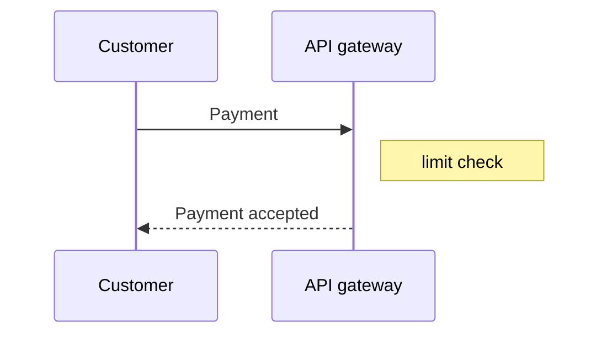

# Diagrams

The engine is chosen by file extension: `.puml` is rendered by PlantUML, `.d2` by D2, `.bpmn`
by the BPMN engine, `.mmd` by mermaid, `.wireflow.json` by Wireflow. The formats can live in one project and even in one folder, as long as the
file names differ.

## PlantUML

c4builder runs the bundled PlantUML jar directly with `java`; layout is computed by the built-in
Smetana engine. There is no Graphviz to install. The jar version is pinned in the package, so
updating PlantUML on a developer machine does not change the build.

**C4 without internet.** The C4-PlantUML library is built into the jar; include it through the
stdlib:

```puml
@startuml
!include <C4/C4_Container>
!include ../styles.iuml

Person(user, "Customer")
System(bank, "Internet banking")
Rel(user, bank, "Uses", "HTTPS")
@enduml
```

**Shared styles** go into an `.iuml`: `skinparam`, `UpdateElementStyle(...)`, your own macros.
Include it after the C4 include with a relative path. Paths in `!include` are relative to the
diagram's folder, not to the project root.

**Cyrillic** works in labels, descriptions and folder names: the diagram font contains it.

**ditaa** (`@startditaa`) is supported too and is always rendered as PNG.

## Diagrams inside a page

A ```` ```plantuml ```` block in an `.md` page is rendered at build time just like a `.puml`
file: the site, the markdown collection and the complete document get an image in its place,
not the block text. `@startuml`/`@enduml` may be omitted, `!include` paths are relative to the
page's folder. A broken block does not fail the build: the image is replaced by a placeholder
and the log shows a warning with the `.md` file path.

`mermaid` blocks are rendered the same way — see the Mermaid section below. To show diagram
source as code, mark the block `puml` or `text`: such blocks stay code, and so
do ```` ```d2 ```` blocks.

## Determinism and the font

Diagrams are drawn with the bundled Nimbus Sans font (Helvetica metrics, Cyrillic, Greek) rather
than a system font. The same diagram therefore has identical geometry on macOS, Linux, in CI and
in Docker, and the SVG diff in a pull request shows only real changes.

`useSystemFonts: true` in `.c4builder` (or `--system-fonts` for one run) switches to system
fonts. The look becomes more familiar, but the result depends on the machine.

## Render cache

Unchanged diagrams are not rendered again: c4builder keeps checksums in `.c4builder.cache`. A
checksum covers the source, all local `!include`s and D2 imports, the output path and the render
settings, plus the engine package versions for D2, BPMN and mermaid and the vendored template catalog version for wireflow. Editing a shared `styles.iuml` re-renders every diagram that includes it, and only
those.

Checksums are saved as the rendering goes (at most twice a second and at the end of the phase),
not only when the build finishes: a build interrupted with Ctrl+C or failed on one diagram keeps
everything already rendered in the cache, and the next build continues from there. The cache is
portable between machines and CI jobs as long as the c4builder version and the font mode match —
see "Docker and CI".

PlantUML diagrams are rendered in parallel: each one is a separate `java` process, by default
`min(4, CPU − 1)` at a time but at least one. The `C4BUILDER_RENDER_CONCURRENCY` environment
variable (an integer ≥ 1) sets the number of processes explicitly — more on a powerful machine, `1`
on a weak one. It does not affect the result: the output is byte-identical for any value. D2,
BPMN and mermaid render one diagram at a time, in parallel with the PlantUML pool.

## D2

[D2](https://d2lang.com) is rendered by the WASM build of the engine right inside Node — no
external binaries. A markdown reference looks the same as for PlantUML: ``.

- The engine is an optional dependency, `@terrastruct/d2` (~60 MB). npm installs it together with
  c4builder, and it is loaded only when the project contains a `.d2`. If the package is missing
  (for example, installed with `--omit=optional`), the build stops with the hint
  `npm install @terrastruct/d2`.
- [Imports](https://d2lang.com/tour/imports) `@file` and `...@file` are resolved by c4builder
  itself, no network needed. Prefix a shared class library with `_` (`_c4lib.d2`) so it is not
  rendered as a diagram of its own: `...@../_c4lib`.
- Layout is set by the `d2Layout` key: `dagre` (default) or `elk`.

## BPMN

`.bpmn` is a business process in BPMN 2.0 notation: events, tasks, gateways, horizontal pools
and lanes, message flows between participants. A markdown reference is the usual one:
``.

**Only the semantics are written.** The file is standard BPMN 2.0 XML: a `collaboration` with
participants (pools) and message flows, a `process` with a `laneSet`, nodes and sequence flows.
Coordinates (the `bpmndi:BPMNDiagram` section) are not needed, and if present they are ignored:
layout is always done by the build. `incoming`/`outgoing` elements are optional, connections are
taken from `sourceRef`/`targetRef`.

```xml
<bpmn:definitions xmlns:bpmn="http://www.omg.org/spec/BPMN/20100524/MODEL"
                  id="Definitions_1" targetNamespace="https://example.com/bpmn">
  <bpmn:process id="Process_1" name="Request" isExecutable="false">
    <bpmn:startEvent id="Start" name="Request received" />
    <bpmn:userTask id="Check" name="Check request" />
    <bpmn:endEvent id="End" name="Request handled" />
    <bpmn:sequenceFlow id="Flow_1" sourceRef="Start" targetRef="Check" />
    <bpmn:sequenceFlow id="Flow_2" sourceRef="Check" targetRef="End" />
  </bpmn:process>
</bpmn:definitions>
```

**Example** — the account opening process from the `c4builder new` template: two pools, lanes,
messages to the credit bureau, a timer escalation. The file holds semantics only; this build did
the layout and rendering:


**Layout** is done by [bpmn-auto-layout](https://github.com/bpmn-io/bpmn-auto-layout): pools and
lanes as horizontal bands labelled on the left, flow from left to right, every node inside the
band of its lane. Sub-processes are drawn collapsed — put their details into a separate `.bpmn`.
The layouter is still alpha: if it loses a model element, the build stops with an error listing
the element ids instead of publishing a truncated diagram. A bad layout cannot be fixed with
manual coordinates — simplify the model or split it into an overview and details.

**Rendering** uses [bpmn-js](https://bpmn.io) in the standard notation, without a browser or
network. Text is measured with the bundled Nimbus Sans, so the SVG is the same on any machine
(`useSystemFonts` does not affect BPMN); PNG comes from the regular rasterization.

**Model checks** run before layout — both in the build and in `c4builder check`. The rule set is
fixed: the recommended [bpmnlint](https://github.com/bpmn-io/bpmnlint) rules (except
`no-bpmndi`) plus the c4builder rules:

| Rule | Level | Checks |
|---|---|---|
| `no-disconnected`, `start-event-required`, `end-event-required`, `label-required`, … | error | bpmnlint recommended set |
| `c4builder/lane-membership` | error | in a process with lanes, every node is in exactly one lane |
| `c4builder/sequence-flow-in-pool` | error | a sequence flow does not cross a pool boundary |
| `c4builder/message-flow-between-pools` | error | a message flow connects different pools |
| `c4builder/gateway-flow-labels` | warning | branches of an XOR/inclusive gateway are labelled |

An error stops rendering of the diagram, a warning is only printed. Each violation is a line of
its own with the element id and the rule name:

```text
✗ src/process.bpmn: Task_Check [no-disconnected] Element is not connected
⚠ src/process.bpmn: Flow_No [c4builder/gateway-flow-labels] Outgoing flow of a diverging gateway has no label
```

**Conventions:** a pool is an organization (an external one is a pool without a process, a
"black box"), a lane is a role or a unit inside it; only message flows go between pools; gateway
branches are labelled; instead of a 40+ node diagram — an overview process plus separate `.bpmn`
files for the details.

**Dependencies.** The engine packages (`bpmn-js`, `bpmn-moddle`, `bpmnlint`, `bpmn-auto-layout`,
`jsdom`) are optional: npm installs them together with c4builder, and they are loaded only when
the project contains a `.bpmn`. Installing with `--omit=optional` keeps only the core — building
a project with `.bpmn` then stops with a hint to reinstall c4builder without that flag.

## Mermaid

[Mermaid](https://mermaid.js.org) is a text diagram notation that agents often write and GitLab
draws by itself. There are two sources: an `.mmd` file (a markdown reference is the usual one:
``) and a block with the `mermaid` language right in a page — it is
rendered the same way as a `plantuml` block. This build rendered both examples below:




**Rendering** uses real mermaid (the single-file `@mermaid-js/tiny` build) in jsdom, without a
browser or network. Text is measured with the bundled Nimbus Sans, so the SVG is the same on any
machine (`useSystemFonts` does not affect mermaid); PNG comes from the regular rasterization. The
look is classic with the `default` theme; it is not pixel-identical to GitLab, which uses another
font. `%%{init: …}%%` and frontmatter `config:` work, except for the pinned keys `look`,
`htmlLabels`, `fontFamily`, `securityLevel` and `themeCSS`: they would break offline rendering.

**Types.** `flowchart`/`graph` (with `subgraph`), `sequenceDiagram`, `stateDiagram-v2`,
`erDiagram`, `classDiagram`, `gantt` and `pie` are guaranteed; `gitGraph`, `timeline`,
`quadrantChart`, `xychart`, `sankey`, `block`, `packet`, `kanban`, `radar` and `journey` render
too. `mindmap`, `architecture` and KaTeX math are not supported — the build names the type in an
explicit error instead of publishing an empty image.

**Errors.** An error in an `.mmd` stops the build, as in any diagram file. An error in a block
does not: the image is replaced by a placeholder and the log shows a warning with the `.md` file
path. The message carries the line number: `✗ src/flow.mmd: line 3: …`. To show mermaid source as
code, mark the block `text`.

**Limits.** `stateDiagram` labels are left-aligned — mermaid draws them that way without HTML
labels in a browser too. Mermaid C4 diagrams are laid out differently than in a browser: write C4
in PlantUML. A word without spaces wider than its node is wrapped by mermaid character by
character.

**Dependencies.** The engine package `@mermaid-js/tiny` (~3 MB) and `jsdom` are optional: they are
loaded only when the project contains an `.mmd` or a `mermaid` block. With `--omit=optional`, a
project with an `.mmd` stops and a block becomes a placeholder — with a hint to reinstall
c4builder without that flag.

## Wireflow

[Wireflow](https://github.com/vanila-io/wireflow) is an open-source user-flow editor: screen
cards from ready-made templates, notes, groups and transitions between them. The file the editor
saves with the Export JSON button goes into a page folder as is and is rendered as an image. A
markdown reference is the usual one: ``. The example below was
rendered by this build:


**File names.** A Wireflow diagram is a file named `wireflow.json` (the editor's export name) or
ending in `.wireflow.json`, case-insensitive. The image is named without the suffix:
`sign-in.wireflow.json` → `sign-in.svg`, `wireflow.json` → `wireflow.svg`. Other `.json` files are
regular files and are copied to the output as before. The file stays an editor export: you can
open it in Wireflow, edit it and save it back.

**Rendering** is c4builder's own, without a browser, network or npm dependencies: the SVG is
built straight from the JSON. Geometry, colours and edge shapes (bezier, step, smooth step)
follow the editor, and screen templates come from the Wireflow catalog vendored into the package
(`vendor/wireflow/`, 125 templates, MIT). Text is set in the bundled Nimbus Sans instead of the
editor's font, so the SVG is identical on any machine, and PNG comes from the regular
rasterization. A long card header is cut with an ellipsis, note text wraps to the note width.
Control characters that XML does not allow (such as the U+000B line break pasted from Word) do
not break the render: U+000B and U+000C in texts become line breaks, the rest are dropped.
Estimates, rates and stages (`settings`) do not affect the image.

**Format versions.** Files `{"format": "wireflow", "version": 2…4}` — what the current editor
saves — are supported. Old-format files (version 1 and files without the `format` field) fail
with advice to open and re-save the file in the current Wireflow; a version newer than 4 fails
with the version number.

**Errors and placeholders.** An edge to a missing node, a `parentId` to a missing group, a node
without `id` or `position` is an error with the file name and the element id, and the build
stops. An unknown screen template is a warning and a placeholder card with the template id. A
card's own image (`own-image`) is embedded when it is a PNG, JPEG or WebP `data:` URL; an external
address is not fetched (the build does not use the network) — a placeholder and a warning take its
place. WebP is not rasterized to PNG: with `diagramFormat: png` such a card becomes a placeholder
too.

**Limits.** There is no ```` ```wireflow ```` block in pages: wireflow is file-only. In
`llms-full.txt` the source goes as a `json` block, with embedded images replaced by an
`"<embedded image>"` marker.

## PNG

With `diagramFormat: png`, c4builder renders SVG and rasterizes it with
[resvg](https://github.com/thx/resvg-js) using the same bundled font. The PNG is consistent for
PlantUML, D2, BPMN, mermaid and wireflow and needs no browser. ditaa stays a native PlantUML PNG.

## Online PlantUML server

With `generateLocalImages: false`, diagrams are not rendered locally: the output links to the
server from `plantumlServerUrl` (default `https://www.plantuml.com/plantuml`). This means diagram
sources go to an external server, and D2, BPMN, mermaid and wireflow do not work in this mode — the build stops
with an error. The mode is kept for compatibility; local rendering is the main one.

## Checking individual diagrams

```bash
c4builder check src/context.puml "src/4 D2 Example/landscape.d2"
```

`check` validates `.puml`, `.iuml`, `.d2`, `.bpmn`, `.mmd` and `.wireflow.json`/`wireflow.json` files with the same engine as the
build (for `.bpmn`: parsing, rules, layout and rendering; for wireflow: file structure and rendering), but writes nothing and needs no project
or `.c4builder`. Exit code 0 means every file compiles, 1 means there is an error (warnings do not
affect the code):

```text
✓ src/context.puml
✗ src/system.puml: line 4: Fatal parsing error
```

`!include` is resolved from the folder of the checked file. An `.iuml` library is checked by
including it into an empty diagram, and an `.iuml` with C4 macros (`UpdateElementStyle` and the
like) — in the context of the C4 stdlib, as in the diagrams that include it. No line number is
printed for an `.iuml`.

A pre-commit hook that checks staged diagrams (`.git/hooks/pre-commit`; spaces in paths are
fine):

```bash
#!/bin/sh
git diff --cached --name-only -z --diff-filter=ACM -- '*.puml' '*.iuml' '*.d2' '*.bpmn' '*.mmd' '*wireflow.json' | xargs -0 -r c4builder check
```
