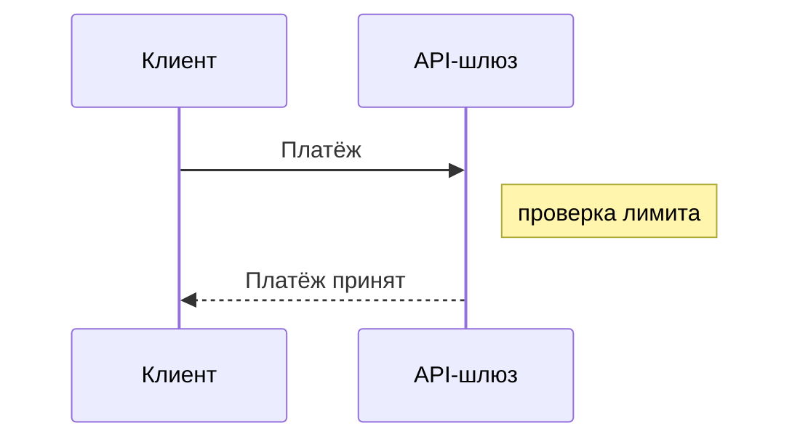

# Диаграммы

Движок выбирается по расширению файла: `.puml` рендерит PlantUML, `.d2` — D2, `.bpmn` —
BPMN-движок, `.mmd` — mermaid, `.wireflow.json` — Wireflow. Форматы могут жить в одном проекте и даже в одной папке, если у файлов разные
имена.

## PlantUML

c4builder запускает вендорный PlantUML-jar напрямую через `java`, раскладку считает встроенный
движок Smetana. Graphviz ставить не нужно. Версия jar зафиксирована в пакете, поэтому
обновление PlantUML на машине разработчика сборку не меняет.

**C4 без интернета.** Библиотека C4-PlantUML встроена в jar, подключайте её через stdlib:

```puml
@startuml
!include <C4/C4_Container>
!include ../styles.iuml

Person(user, "Клиент")
System(bank, "Интернет-банк")
Rel(user, bank, "Пользуется", "HTTPS")
@enduml
```

**Общие стили** — в `.iuml`: `skinparam`, `UpdateElementStyle(...)`, свои макросы. Подключаются
после C4-инклюда относительным путём. Пути в `!include` считаются от папки диаграммы, а не от
корня проекта.

**Кириллица** работает в подписях, описаниях и именах папок: шрифт диаграмм её содержит.

**ditaa** (`@startditaa`) тоже поддерживается и всегда рендерится в PNG.

## Диаграмма прямо в странице

Блок ```` ```plantuml ```` в `.md`-странице рендерится при сборке так же, как файл `.puml`: в
сайте, markdown-коллекции и общем документе на его месте будет картинка, а не текст блока.
`@startuml`/`@enduml` можно опустить, `!include` считаются от папки страницы. Блок с ошибкой
сборку не роняет: на месте картинки — заглушка, в логе — предупреждение с путём `.md`-файла.

Так же рендерятся блоки `mermaid` — см. раздел Mermaid ниже. Чтобы показать исходник
диаграммы как код, пометьте блок `puml` или `text`: такие блоки, как и ```` ```d2 ````,
остаются кодом.

## Детерминизм и шрифт

Диаграммы рисуются вендорным шрифтом Nimbus Sans (метрики Helvetica, кириллица, греческий),
а не системным. Поэтому одна и та же диаграмма даёт одинаковую геометрию на macOS, Linux,
в CI и в Docker, а дифф SVG в pull request показывает только реальные изменения.

`useSystemFonts: true` в `.c4builder` (или `--system-fonts` на один запуск) включает системные
шрифты. Вид станет привычнее, но результат будет зависеть от машины.

## Кэш рендера

Неизменённые диаграммы при повторной сборке не рендерятся: c4builder хранит чексуммы в
`.c4builder.cache`. В чексумму входят исходник, все локальные `!include` и D2-импорты, путь
выхода и параметры рендера, для D2, BPMN и mermaid — ещё версии пакетов движка, для wireflow — версия вендоренного каталога шаблонов. Правка общего `styles.iuml` перерисует все диаграммы, которые
его подключают, и только их.

Чексуммы сохраняются по мере рендера (не чаще раза в полсекунды и в конце фазы), а не только по
окончании сборки: прерванная по Ctrl+C или упавшая на одной диаграмме сборка оставляет в кэше
всё, что успело отрендериться, и следующая продолжает с места остановки. Кэш переносим между
машинами и джобами CI, если совпадают версия c4builder и режим шрифтов — см. «Docker и CI».

PlantUML-диаграммы рендерятся параллельно: каждая — отдельный процесс `java`, по умолчанию
`min(4, CPU − 1)` одновременно, но не меньше одного. Переменная окружения
`C4BUILDER_RENDER_CONCURRENCY` (целое ≥ 1) задаёт число процессов явно — например, больше на
мощной машине или `1` на слабой. На результат рендера она не влияет: выход побайтно одинаков
при любом значении. D2, BPMN и mermaid рендерятся по одной диаграмме за раз, параллельно
пулу PlantUML.

## D2

[D2](https://d2lang.com) рендерится через WASM-сборку движка прямо в Node — без внешних
бинарников. Ссылка из markdown такая же, как для PlantUML: ``.

- Движок — опциональная зависимость `@terrastruct/d2` (~60 МБ). npm ставит её вместе с
  c4builder, а загружается она только если в проекте есть `.d2`. Если пакета нет (например,
  установка шла с `--omit=optional`), сборка остановится с подсказкой `npm install @terrastruct/d2`.
- [Импорты](https://d2lang.com/tour/imports) `@file` и `...@file` разрешает сам c4builder,
  сеть не нужна. Общую библиотеку классов назовите с `_` (`_c4lib.d2`), чтобы она не
  рендерилась отдельной диаграммой: `...@../_c4lib`.
- Раскладка — ключ `d2Layout`: `dagre` (по умолчанию) или `elk`.

## BPMN

`.bpmn` — бизнес-процесс в нотации BPMN 2.0: события, задачи, шлюзы, горизонтальные пулы и
дорожки, message flow между участниками. Ссылка из markdown обычная: ``.

**Пишется только семантика.** Файл — стандартный BPMN 2.0 XML: `collaboration` с участниками
(пулами) и message flow, `process` с `laneSet`, узлами и sequence flow. Координаты (секция
`bpmndi:BPMNDiagram`) не нужны, а если они есть — игнорируются: раскладку всегда делает
сборка. Элементы `incoming`/`outgoing` писать не обязательно, связи берутся из
`sourceRef`/`targetRef`.

```xml
<bpmn:definitions xmlns:bpmn="http://www.omg.org/spec/BPMN/20100524/MODEL"
                  id="Definitions_1" targetNamespace="https://example.com/bpmn">
  <bpmn:process id="Process_1" name="Заявка" isExecutable="false">
    <bpmn:startEvent id="Start" name="Заявка получена" />
    <bpmn:userTask id="Check" name="Проверить заявку" />
    <bpmn:endEvent id="End" name="Заявка обработана" />
    <bpmn:sequenceFlow id="Flow_1" sourceRef="Start" targetRef="Check" />
    <bpmn:sequenceFlow id="Flow_2" sourceRef="Check" targetRef="End" />
  </bpmn:process>
</bpmn:definitions>
```

**Пример** — процесс открытия счёта из шаблона `c4builder new`: два пула, дорожки, обмен
сообщениями с бюро кредитных историй, таймер-эскалация. В файле только семантика, раскладку и
рендер сделала эта сборка:


**Раскладка** — [bpmn-auto-layout](https://github.com/bpmn-io/bpmn-auto-layout): пулы и
дорожки горизонтальными полосами с подписью слева, поток слева направо, каждый узел в полосе
своей дорожки. Подпроцессы рисуются свёрнутыми — детализацию выносите в отдельный `.bpmn`.
Раскладчик пока в alpha: если он потеряет элемент модели, сборка остановится с ошибкой и id
элементов, а не выпустит урезанную схему. Ручными координатами неудачную раскладку не
поправить — упростите модель или разбейте её на обзор и детализацию.

**Рендер** — [bpmn-js](https://bpmn.io) в стандартной нотации, без браузера и сети. Текст
меряется по вендорному Nimbus Sans, поэтому SVG одинаков на любой машине (режим
`useSystemFonts` на BPMN не влияет), PNG — штатной растеризацией.

**Проверка модели** идёт перед раскладкой — и в сборке, и в `c4builder check`. Набор правил
фиксирован: рекомендованные правила [bpmnlint](https://github.com/bpmn-io/bpmnlint) (кроме
`no-bpmndi`) и правила c4builder:

| Правило | Уровень | Что проверяет |
|---|---|---|
| `no-disconnected`, `start-event-required`, `end-event-required`, `label-required`, … | error | рекомендованный набор bpmnlint |
| `c4builder/lane-membership` | error | у процесса с дорожками каждый узел ровно в одной дорожке |
| `c4builder/sequence-flow-in-pool` | error | sequence flow не пересекает границу пула |
| `c4builder/message-flow-between-pools` | error | message flow соединяет разные пулы |
| `c4builder/gateway-flow-labels` | warning | ветки XOR/inclusive-шлюза подписаны |

Ошибка останавливает рендер диаграммы, предупреждение только печатается. Каждое нарушение —
отдельная строка с id элемента и именем правила:

```text
✗ src/process.bpmn: Task_Check [no-disconnected] Element is not connected
⚠ src/process.bpmn: Flow_No [c4builder/gateway-flow-labels] Outgoing flow of a diverging gateway has no label
```

**Конвенции:** пул — организация (внешняя — пулом без процесса, «чёрным ящиком»), дорожка —
роль или подразделение внутри неё; между пулами только message flow; ветки шлюза подписаны;
вместо диаграммы на 40+ узлов — обзорный процесс и отдельные `.bpmn` для подробностей.

**Зависимости.** Пакеты движка (`bpmn-js`, `bpmn-moddle`, `bpmnlint`, `bpmn-auto-layout`,
`jsdom`) — опциональные: npm ставит их вместе с c4builder, а загружаются они, только если в
проекте есть `.bpmn`. Установка с `--omit=optional` оставляет только ядро — сборка проекта с
`.bpmn` остановится с подсказкой переустановить c4builder без этого флага.

## Mermaid

[Mermaid](https://mermaid.js.org) — текстовые диаграммы, которые часто пишут агенты и которые
GitLab рисует сам. Источников два: файл `.mmd` (ссылка из markdown обычная:
``) и блок с языком `mermaid` прямо в странице — он рендерится так
же, как блок `plantuml`. Оба примера ниже отрендерила эта сборка:




**Рендер** — настоящий mermaid (однофайловая сборка `@mermaid-js/tiny`) в jsdom, без браузера
и сети. Текст меряется по вендорному Nimbus Sans, поэтому SVG одинаков на любой машине (режим
`useSystemFonts` на mermaid не влияет), PNG — штатной растеризацией. Вид классический, тема
`default`; пиксельного совпадения с GitLab нет — там другой шрифт. `%%{init: …}%%` и `config:`
во frontmatter работают, кроме закреплённых ключей `look`, `htmlLabels`, `fontFamily`,
`securityLevel` и `themeCSS`: они сломали бы офлайн-рендер.

**Типы.** Гарантированы `flowchart`/`graph` (с `subgraph`), `sequenceDiagram`,
`stateDiagram-v2`, `erDiagram`, `classDiagram`, `gantt` и `pie`; рендерятся и `gitGraph`,
`timeline`, `quadrantChart`, `xychart`, `sankey`, `block`, `packet`, `kanban`, `radar`,
`journey`. `mindmap`, `architecture` и формулы KaTeX не поддерживаются — сборка назовёт тип в
явной ошибке, а не выпустит пустую картинку.

**Ошибки.** Ошибка в `.mmd` останавливает сборку, как в любом файле диаграммы. Ошибка в блоке —
нет: на месте картинки заглушка, в логе предупреждение с путём `.md`-файла. В сообщении — номер
строки: `✗ src/flow.mmd: line 3: …`. Чтобы показать исходник mermaid кодом, пометьте блок
`text`.

**Пределы.** Подписи `stateDiagram` выровнены влево — так mermaid рисует их без HTML-подписей
и в браузере. C4-диаграммы mermaid раскладываются иначе, чем в браузере: C4 пишите на PlantUML.
Слово без пробелов шире узла mermaid переносит посимвольно.

**Зависимости.** Пакет движка `@mermaid-js/tiny` (~3 МБ) и `jsdom` — опциональные: загружаются,
только если в проекте есть `.mmd` или блок `mermaid`. При установке с `--omit=optional` сборка
проекта с `.mmd` остановится, а блок станет заглушкой — с подсказкой переустановить c4builder
без этого флага.

## Wireflow

[Wireflow](https://github.com/vanila-io/wireflow) — открытый редактор пользовательских
сценариев: экраны-карточки из готовых шаблонов, заметки, группы и переходы между ними. Файл,
который редактор сохраняет кнопкой Export JSON, кладётся в папку страницы как есть и рендерится
картинкой. Ссылка из markdown обычная: ``. Пример ниже отрендерила
эта сборка:


**Имена файлов.** Wireflow-диаграмма — файл с именем `wireflow.json` (так редактор называет
экспорт) или оканчивающийся на `.wireflow.json`, регистр не важен. Картинка называется по имени
без суффикса: `sign-in.wireflow.json` → `sign-in.svg`, `wireflow.json` → `wireflow.svg`. Прочие
`.json` — обычные файлы, они копируются в выход как раньше. Файл так и остаётся экспортом
редактора: его можно открыть в Wireflow, поправить и сохранить обратно.

**Рендер** — собственный, без браузера, сети и npm-зависимостей: SVG строится прямо из JSON.
Геометрия, цвета и формы рёбер (кривая, ступенька, скруглённая ступенька) повторяют редактор,
шаблоны экранов берутся из каталога Wireflow, вендоренного в пакет (`vendor/wireflow/`, 125
шаблонов, MIT). Текст набирается вендорным Nimbus Sans вместо шрифта редактора, поэтому SVG
одинаков на любой машине, а PNG получается штатной растеризацией. Длинный заголовок карточки
обрезается многоточием, текст заметки переносится по ширине. Управляющие символы, недопустимые
в XML (например, разрыв строки U+000B из Word), рендер не ломают: U+000B и U+000C в текстах
становятся переводом строки, остальные отбрасываются. Оценки, ставки и этапы
(`settings`) на картинку не влияют.

**Версии формата.** Поддерживаются файлы `{"format": "wireflow", "version": 2…4}` — их
сохраняет текущий редактор. Файлы старого формата (версия 1 и файлы без поля `format`) дают
ошибку с советом открыть и пересохранить файл в текущем Wireflow; версия новее 4 — ошибку с
номером версии.

**Ошибки и заглушки.** Ребро на несуществующий узел, `parentId` на несуществующую группу, узел
без `id` или `position` — ошибка с именем файла и id элемента, сборка останавливается. Неизвестный
шаблон экрана — предупреждение и карточка-заглушка с id шаблона. Собственная картинка карточки
(`own-image`) встраивается, если это `data:`-URL PNG, JPEG или WebP; внешний адрес не
загружается (сборка не ходит в сеть) — на его месте заглушка и предупреждение. WebP не
растеризуется в PNG: при `diagramFormat: png` такая карточка тоже станет заглушкой.

**Пределы.** Блока ```` ```wireflow ```` в странице нет: wireflow — только файлом. В
`llms-full.txt` исходник идёт блоком `json`, встроенные картинки заменены пометкой
`"<embedded image>"`.

## PNG

С `diagramFormat: png` c4builder рендерит SVG и растеризует его через
[resvg](https://github.com/thx/resvg-js) тем же вендорным шрифтом. PNG получается
одинаковым для PlantUML, D2, BPMN, mermaid и wireflow и не требует браузера. ditaa остаётся нативным PNG PlantUML.

## Онлайн-сервер PlantUML

С `generateLocalImages: false` диаграммы не рендерятся локально: в выход попадают ссылки на
сервер из `plantumlServerUrl` (по умолчанию `https://www.plantuml.com/plantuml`). Это значит,
что исходники диаграмм уходят на внешний сервер, а D2, BPMN, mermaid и wireflow в этом режиме не работают —
сборка остановится с ошибкой. Режим оставлен для совместимости; основной — локальный рендер.

## Проверка отдельных диаграмм

```bash
c4builder check src/context.puml "src/4 D2 Example/landscape.d2"
```

`check` проверяет `.puml`, `.iuml`, `.d2`, `.bpmn`, `.mmd` и `.wireflow.json`/`wireflow.json` тем же движком, что и сборка (для
`.bpmn` — разбор, правила, раскладка и рендер; для wireflow — структура файла и рендер), но ничего не пишет и не требует проекта или
`.c4builder`.
Код выхода 0 — все файлы собираются, 1 — есть ошибка (предупреждения на код не влияют):

```text
✓ src/context.puml
✗ src/system.puml: line 4: Fatal parsing error
```

`!include` разрешается от папки проверяемого файла. Библиотека `.iuml` проверяется включением
в пустую диаграмму, а `.iuml` с макросами C4 (`UpdateElementStyle` и т. п.) — в контексте
C4-stdlib, как в диаграммах, которые его подключают. Номер строки для `.iuml` не печатается.

Pre-commit-хук, который проверяет диаграммы в индексе (`.git/hooks/pre-commit`, пробелы в
путях не мешают):

```bash
#!/bin/sh
git diff --cached --name-only -z --diff-filter=ACM -- '*.puml' '*.iuml' '*.d2' '*.bpmn' '*.mmd' '*.wireflow.json' 'wireflow.json' '*/wireflow.json' | xargs -0 -r c4builder check
```
