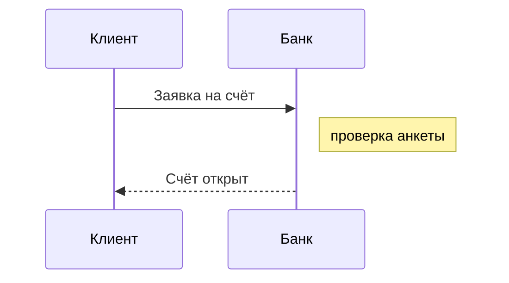

# Mermaid reference

Mermaid diagrams are rendered **at build time** by real mermaid (the official
`@mermaid-js/tiny` build) running in jsdom — no browser, no network. Text is measured with
the bundled Nimbus Sans, so the SVG is identical on every machine. Every output (site,
markdown, complete markdown, PNG) gets an image; the browser never sees diagram source.

## When mermaid, when PlantUML

- **C4 model** (context, containers, components, deployment) — PlantUML with the C4 stdlib,
  see [diagrams.md](diagrams.md). Mermaid C4 diagrams may lay out differently than in a browser.
- **Mermaid** — flows and processes inside documentation and OpenSpec artifacts:
  `flowchart`/`graph` (with `subgraph`), `sequenceDiagram`, `stateDiagram-v2`, `erDiagram`,
  `classDiagram`, `gantt`, `pie` and other types of the tiny build.
- **Business processes with pools and lanes** — BPMN, see [bpmn.md](bpmn.md).

## Two sources

- **A `.mmd` file** in a page folder, like `.puml`/`.d2`/`.bpmn`: rendered to `<name>.svg`
  (or `.png` with `diagramFormat: png`) and attached to the page, or placed inline with
  ``. `flow.mmd` and `flow.puml` in one folder collide on the image name.
- **A ```` ```mermaid ```` block** in a page `.md` or in an OpenSpec artifact (`design.md`,
  `proposal.md`, specs): replaced by its image in every output, like a ```` ```plantuml ````
  block. To show mermaid source as code instead, fence it as `text`.



## Conventions

- Keep labels short. A label longer than ~200 px wraps at spaces; a single long word
  without spaces is split by mermaid character by character.
- Non-Latin text (Cyrillic etc.) works in ids and labels.
- The look is fixed: `look: classic`, theme `default`, SVG text labels. `%%{init: …}%%` and
  frontmatter `config:` cannot change `look`, `htmlLabels`, `fontFamily`, `securityLevel` or
  `themeCSS`; other keys (`theme`, `flowchart.curve`, spacing) work as in mermaid.
- Not supported: `mindmap`, `architecture` and KaTeX math (`$$…$$`) — they are not in the
  tiny build and fail with an explicit `unsupported mermaid …` error.
- Clicks, tooltips and links are not interactive: the image is static.

## The loop

```bash
c4builder check "src/3 Processes/flow.mmd"
```

`check` parses and renders the file exactly like the build, without a project. Exit code 0
means the diagram builds. Errors carry the line of the file (frontmatter and comments
counted):

```text
✗ src/3 Processes/flow.mmd: line 3: ...A --> B  B -->> ((C; Expecting 'AMP', 'COLON', 'PIPE', ..., got 'TAGEND'
✗ src/3 Processes/map.mmd: line 1: unsupported mermaid diagram type 'mindmap'
```

Fix the line and run `check` again until the exit code is 0, then build. A
```` ```mermaid ```` block cannot be checked on its own: build the project and read the
warnings, or copy the block into a temporary `.mmd`.

- An error in a `.mmd` file fails the build with the file path and line.
- An error in a ```` ```mermaid ```` block does not: the build exits with 0, the image is
  a placeholder with the error, and the log has a warning naming the source `.md`.

## Output and dependencies

- In `llms-full.txt` a mermaid diagram (file or block) appears as its source in a
  `mermaid` block.
- The engine package `@mermaid-js/tiny` (about 2.7 MB, with `jsdom`) is an optional npm
  dependency, loaded only when the project has mermaid. An install with `--omit=optional`
  stops a `.mmd` build (and turns blocks into placeholders) with a hint to reinstall c4builder
  without that flag.
- Like D2 and BPMN, mermaid has no online renderer: `generateLocalImages` must stay `true`.
