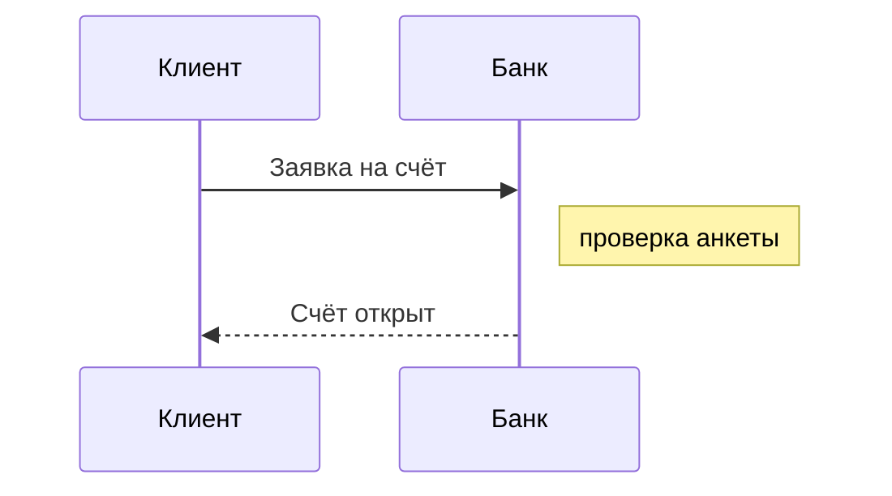

**Диаграммы Mermaid (четвёртый бэкенд рендера)**

Mermaid-диаграммы бывают двух видов. Файл `flow.mmd` в папке раздела рендерится как `.puml`, `.d2` и `.bpmn`: картинка по имени файла. Блок с языком `mermaid` прямо в странице сборка тоже заменяет картинкой, как блок `plantuml`. В браузер текст диаграммы не попадает, клиентский рендер не нужен.

Рендерит настоящий mermaid в классическом виде с темой `default`, но без браузера: размеры текста считаются по вендорному шрифту, поэтому картинка одинакова на любой машине. Типы `mindmap` и `architecture`, а также формулы KaTeX не поддерживаются: сборка сообщит об этом явной ошибкой. Ошибка в файле `.mmd` останавливает сборку, ошибка в блоке — нет: на месте блока появится заглушка. Отдельный файл проверяется командой `c4builder check flow.mmd`.

**Область применения**: показать, что `.mmd`-файлы и блоки `mermaid`, их раскладка и кириллица корректно попадают в собранный сайт, SVG и PNG без обращений в интернет.
