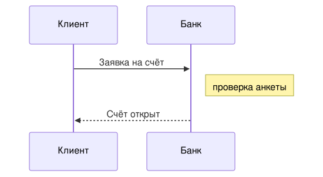

# 6 Mermaid Example

`/6 Mermaid Example`

* [Overview](../README.md)
  * [1 Internet Banking System](../1%20Internet%20Banking%20System/README.md)
    * [API Application](../1%20Internet%20Banking%20System/API%20Application/README.md)
    * [API Specs](../1%20Internet%20Banking%20System/API%20Specs/README.md)
    * [Single Page Application](../1%20Internet%20Banking%20System/Single%20Page%20Application/README.md)
      * [Dynamic Diagram](../1%20Internet%20Banking%20System/Single%20Page%20Application/Dynamic%20Diagram/README.md)
      * [Extended Docs](../1%20Internet%20Banking%20System/Single%20Page%20Application/Extended%20Docs/README.md)
  * [2 Deployment](../2%20Deployment/README.md)
  * [3 Локализация](../3%20%D0%9B%D0%BE%D0%BA%D0%B0%D0%BB%D0%B8%D0%B7%D0%B0%D1%86%D0%B8%D1%8F/README.md)
  * [4 D2 Example](../4%20D2%20Example/README.md)
  * [5 BPMN Example](../5%20BPMN%20Example/README.md)
  * [**6 Mermaid Example**](../6%20Mermaid%20Example/README.md)
  * [7 Wireflow Example](../7%20Wireflow%20Example/README.md)

---

[Overview (up)](../README.md)

---

**Диаграммы Mermaid (четвёртый бэкенд рендера)**

Mermaid-диаграммы бывают двух видов. Файл `flow.mmd` в папке раздела рендерится как `.puml`, `.d2` и `.bpmn`: картинка по имени файла. Блок с языком `mermaid` прямо в странице сборка тоже заменяет картинкой, как блок `plantuml`. В браузер текст диаграммы не попадает, клиентский рендер не нужен.

Рендерит настоящий mermaid в классическом виде с темой `default`, но без браузера: размеры текста считаются по вендорному шрифту, поэтому картинка одинакова на любой машине. Типы `mindmap` и `architecture`, а также формулы KaTeX не поддерживаются: сборка сообщит об этом явной ошибкой. Ошибка в файле `.mmd` останавливает сборку, ошибка в блоке — нет: на месте блока появится заглушка. Отдельный файл проверяется командой `c4builder check flow.mmd`.

**Область применения**: показать, что `.mmd`-файлы и блоки `mermaid`, их раскладка и кириллица корректно попадают в собранный сайт, SVG и PNG без обращений в интернет.

