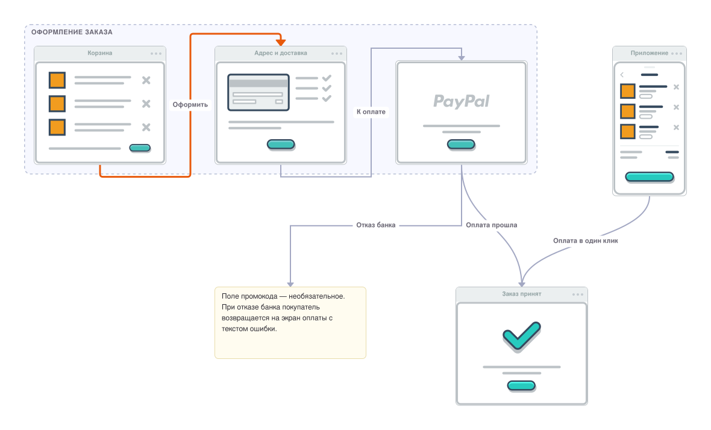

# 7 Wireflow Example

**Пользовательский сценарий Wireflow (пятый бэкенд рендера)**

Файл `checkout.wireflow.json` — экспорт редактора [Wireflow](https://github.com/vanila-io/wireflow) (кнопка «Export JSON»): сценарий оформления заказа вымышленного интернет-магазина. Группа «Оформление заказа» объединяет экраны «Корзина», «Адрес и доставка» и «Оплата» (последний — без заголовка), справа — мобильный экран «Приложение», ниже — экран «Заказ принят» и заметка. Переходы между экранами — трёх видов: скруглённая ступенька с цветом и толщиной, прямая ступенька и кривая, все с подписями.

Сборка рендерит файл сама — без браузера, сети и установки редактора: карточки экранов берутся из вендорного каталога шаблонов Wireflow, геометрия и цвета повторяют редактор, текст набирается вендорным шрифтом, поэтому картинка одинакова на любой машине. Файл так и остаётся экспортом редактора: его можно открыть в Wireflow, поправить и сохранить обратно. Отдельный файл проверяется командой `c4builder check checkout.wireflow.json`.

**Область применения**: показать, что `.wireflow.json`-файлы, их группы, карточки, заметки, рёбра и кириллица корректно попадают в собранный сайт, SVG и PNG без обращений в интернет.

